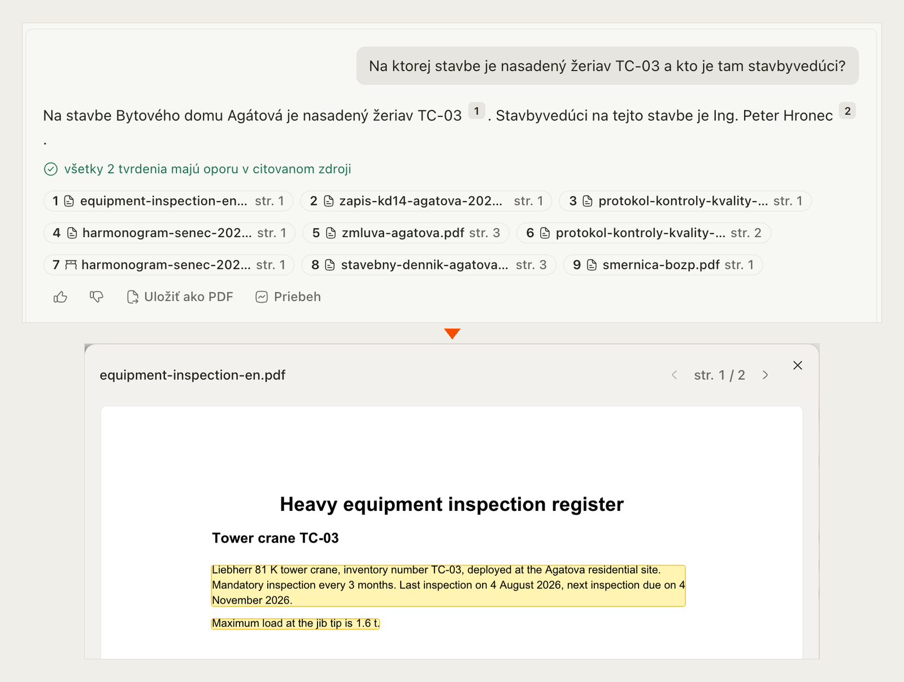
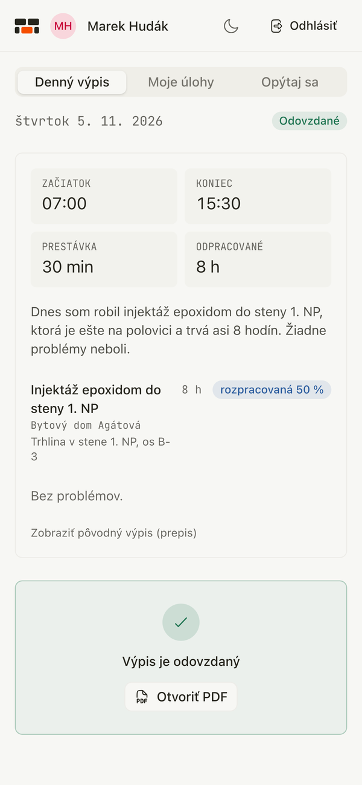
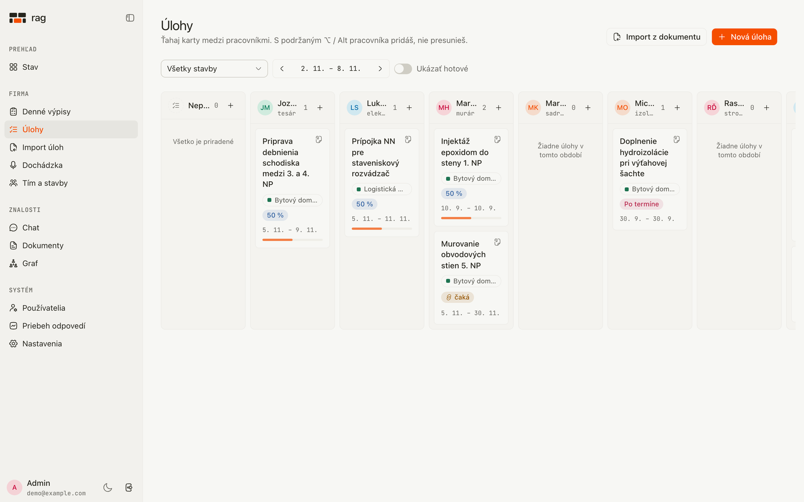
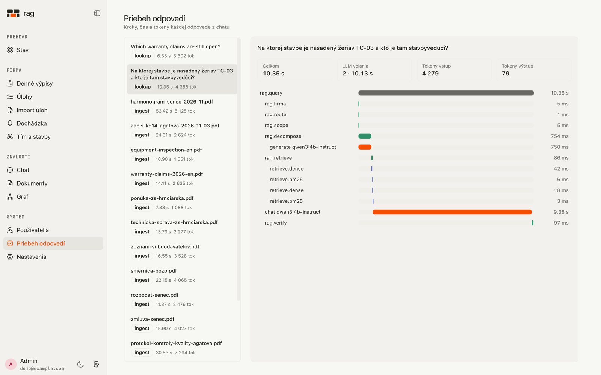
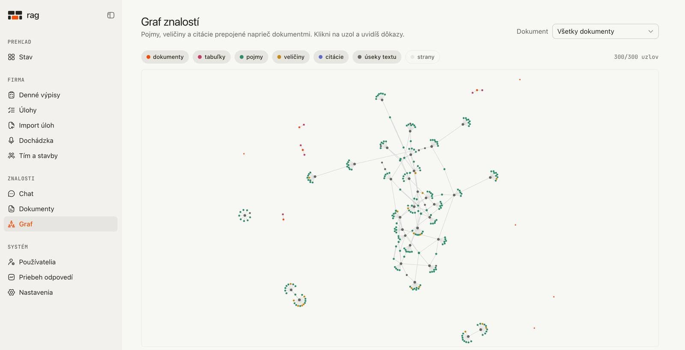
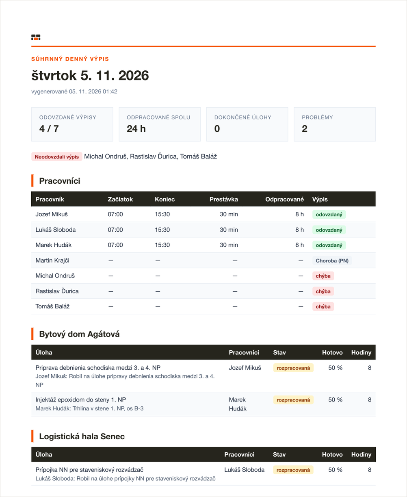
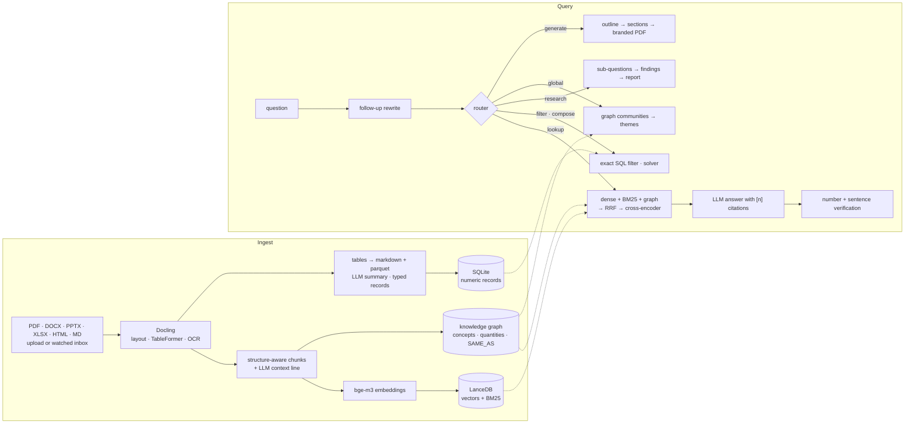

# rag: private document intelligence with a knowledge graph

[](https://github.com/kavicka/rag/actions/workflows/ci.yml)
[](LICENSE)

A local RAG system for a small construction company, evaluated on a **synthetic corpus** with a
128-question golden set. It reads contracts, budgets, site diaries and manuals, answers with
citations that open the exact passage in the PDF, and also runs the company's day-to-day: voice
attendance, tasks and reports from the same data. Everything runs on one machine with a 4B
model; a hosted LLM is one environment variable away.

<!-- EVAL_SUMMARY -->
> Measured on a 128-question golden set over a synthetic corpus, with a local 4B model: **Retrieval MRR 72.9 → 95.5 %** and nDCG@10 76.2 → 96.1 % (plain hybrid → production pipeline); **95.8 %** of answers contain the exact expected facts, **80.0 %** abstain when the corpus has no answer; prompt-injection attack success **16.7 → 0.0 %** with the guard. See [Evaluation](#evaluation).
<!-- /EVAL_SUMMARY -->

**Why this is interesting**

- **Every design choice has a number behind it.** The eval harness ran each technique as an
  ablation. Graph expansion on every query *hurt* (MRR 72.9 → 51.4), so it runs only for
  relational questions. Contextual retrieval and a reranker took MRR from 72.9 to 95.5.
- **The LLM never owns a number, a time or a date.** Hours, deadlines, task states and totals are
  computed by code. Values the model extracts from speech or documents are checked against what
  the person said or the document states; in the eval, 2 numbers the model got wrong were
  dropped and 0 wrong values got through.
- **Security was tested, not assumed.** Prompt-injection success went from 16.7 to 0 % with the
  guard (6 attacks in 3 poisoned documents). The red-team over company data (PINs, passwords,
  injection, secrets inside documents) passed 21 of 21 cases with 0 secret leaks.

All numbers come from small synthetic sets (128 questions, 6 injection attacks, 21 red-team
cases) and one local run each, so read them as engineering evidence, not benchmarks.



*A Slovak question about a crane and a site manager, answered from two documents (one of them
English). Both claims are checked against their sources; citation 1 opens the PDF at the
highlighted passage.*

| | |
|---|---|
| <br>Worker phone: times, task progress and problems extracted from what the worker said | <br>Task board with one column per worker |
| <br>Traces: every pipeline step with tokens and latency | <br>Knowledge graph across documents |
| <br>Daily summary PDF generated for the owner | |

The UI is in Slovak. Names are glossed in English where they first appear below.
All companies and people in the repository, the demo and the eval corpus are fictional.

## Try it

```bash
make demo
```

The command builds a demo from the synthetic corpus and a fictional company in a separate
`demo-data/` folder, then starts the app at <http://localhost:5180> (API on :8010). It ingests
the 12 PDFs, creates 7 workers, 3 sites and their tasks (via the real task import), files
today's reports and two chats — about 6 minutes on an M4 Pro the first time, seconds afterwards.

- Owner: `demo@example.com` / `demo-demo-demo`
- Workers on a phone: pick a name and enter the PIN, e.g. Marek Hudák `1111`, Tomáš Baláž
  `2222` (the command prints them)

`make demo-up` starts an already built demo again, `make demo-reset` deletes it. It uses
`qwen3:4b-instruct` and `qwen3:1.7b`; to use only one model:
`RAG_EXTRACT_MODEL=qwen3:4b-instruct make demo`.

Prerequisites: [Ollama](https://ollama.com), about 4 GB of model downloads (`make models`),
macOS or Linux, Python 3.12 with [uv](https://docs.astral.sh/uv/), Node with pnpm. Voice
features (speech-to-text, spoken questions) need Apple Silicon and the opt-in `make install-voice`;
without them everything else works with text only.

## What it does

### Documents

| | |
|---|---|
| **Ingest** | PDF (incl. scans), DOCX, PPTX, XLSX, HTML, Markdown via Docling: layout, tables, OCR (Apple Vision / Tesseract, Slovak + English). Upload, or drop files into a watched `inbox/` folder (new → indexed, changed → re-indexed, deleted → removed). |
| **Retrieve** | Dense (bge-m3) + BM25 in LanceDB, knowledge-graph expansion for cross-document questions, reciprocal rank fusion, multilingual cross-encoder rerank, Anthropic-style *contextual retrieval* at ingest. Optional ColPali visual page retrieval. |
| **Answer** | Streaming answers with `[n]` citations; a click opens the PDF at the cited page with the passage highlighted. A deterministic check flags numbers in the answer that appear nowhere in the evidence, and a per-sentence check (embedding similarity to the cited source, no LLM) marks sentences as supported, weak or uncited. It is a heuristic, not a proof. Follow-ups are rewritten into standalone queries; compound questions are decomposed. |
| **Route** | `lookup` (RAG) · `filter` (exact numeric filters over any table: *"samples under 38 MPa"*) · `compose` (planner + exact solver) · `research` (sub-questions → findings → structured report) · `global` (themes across the whole library from graph communities) · `generate` (branded PDF). |
| **Generate** | *"Priprav report o kvalite betónu na Agátovej"* ("prepare a report on concrete quality") → outline → sections written from sources → PDF styled like the app. Company details, header and footer come from the Settings page. Any chat answer can be exported to PDF. |
| **Integrate** | MCP server (`ask`, `research`, `search_documents`, `find_connections`, `list_documents`, `get_document`, `generate_document`) over stdio and streamable HTTP, so Claude Desktop / Claude Code can use the library. |
| **Operate** | OpenTelemetry tracing with GenAI semantic conventions (built-in waterfall viewer, optional OTLP → Langfuse / Phoenix), tokens and latency per stage, thumbs up/down linked to the trace, bad answers exportable to the golden set. |

### Company module (Firma)

For a construction firm: the owner assigns work, workers report from site, the owner gets a PDF.
Design rule: **code decides, the LLM only turns free text into structure.**

| | |
|---|---|
| **Voice attendance** | A worker records the daily report on a phone in Slovak (*Dochádzka*, Attendance). Whisper transcribes it, a local LLM extracts times, hours, tasks and their status. Every time and number from the LLM is checked against the transcript; Slovak spoken times and dates are parsed by deterministic code („opol 7“ becomes 6:30, „do konca mesiaca“ becomes the last day of the month). Missing data triggers follow-up questions, read aloud by Piper TTS if installed, answered by voice or text, with buttons after two unclear answers. Submission is blocked on the server until nothing is missing. Worked time and task hours must agree within a tolerance (0.5 h by default). |
| **Worker PIN login** | Workers sign in on their phone with name + PIN (lock after 5 wrong attempts for 15 minutes, 90-day session) and see a worker-only shell: their tasks (*Moje úlohy*), their report, questions about their own data. |
| **Task board** | Sites, tasks with date ranges, dependencies and assignees (*Úlohy*, Tasks). Kanban board with one column per worker: drag to move, Alt+drag to add. |
| **Task import from documents** | (*Import úloh*) Upload a supplier document or meeting minutes. A local LLM proposes tasks, each with a verbatim quote that is checked against the text (a task without evidence is dropped). Deadlines are computed by code, "after X" becomes a dependency, a worker is suggested (named person → profession → on site → workload). The owner approves; the source quote is highlighted in the PDF. A new document version is diffed into new / changed / cancelled / unchanged tasks. |
| **Daily PDF reports** | One branded PDF per worker report and an automatic daily company summary (19:00 by default) in *Denné výpisy* (Daily reports). |
| **Role-gated chat** | The same chat answers questions about tasks, attendance and hours. Admin sees everything, a worker only their own data, a plain member nothing. Answers are built from templates over read-only data, not by the LLM. A scope guard refuses secrets, system internals and off-purpose questions; secrets are redacted before they reach the prompt, the stream and the answer. |

Navigation, as in the app: *Stav* (Status), *Firma* (Denné výpisy, Úlohy, Import úloh, Dochádzka,
*Tím a stavby* = Team and sites), *Znalosti* (Chat, *Dokumenty* = Documents, *Graf* = Graph),
*Systém* (*Používatelia* = Users, Traces, *Nastavenia* = Settings).

## Evaluation

The eval runs in-process against a synthetic but deliberately non-trivial corpus
([backend/eval/construction.py](backend/eval/construction.py)): 12 interlinked documents of
a construction company: two projects with the same document types and similar numbers
(distractors), the same subcontractors and people across contracts, supplier lists and
warranty logs, Slovak and English documents. 128 questions with gold document + page:
factual, table, cross-document, multi-hop and unanswerable.

<!-- EVAL_TABLES -->
| Retrieval configuration | Recall@10 | MRR | nDCG@10 | p50 latency |
|---|---:|---:|---:|---:|
| dense | 90.2 | 76.9 | 78.8 | 27 ms |
| bm25 | 81.8 | 68.2 | 70.7 | 4 ms |
| hybrid (dense+bm25, RRF) | 88.6 | 72.9 | 76.2 | 29 ms |
| hybrid + graph on every query | 87.3 | 51.4 | 59.2 | 34 ms |
| hybrid + graph on relational queries | 88.6 | 73.4 | 76.4 | 29 ms |
| hybrid + graph + rerank | 91.1 | 81.3 | 82.9 | 913 ms |
| contextual + hybrid + graph | 98.7 | 83.8 | 87.4 | 31 ms |
| **contextual + hybrid + graph + rerank** | 99.2 | 95.5 | 96.1 | 852 ms |
| … + visual pages (ColSmol, experimental) | 99.2 | 95.5 | 95.9 | 910 ms |

Answer quality (`contextual + hybrid + graph + rerank`, `qwen3:4b-instruct`):

| Metric | Value |
|---|---:|
| Exact expected facts in the answer | 95.8 % |
| Faithfulness — claims supported by sources (LLM judge) | 90.2 % |
| Valid citations | 100.0 % |
| Abstains on unanswerable questions | 80.0 % |
| False refusals | 0.9 % |
| Average end-to-end latency | 8.95 s |

Prompt injection (6 attacks hidden in 3 poisoned documents):

| | Attack success | Task still answered |
|---|---:|---:|
| No defense | 16.7 % | 100.0 % |
| Injection guard | 0.0 % | 100.0 % |
<!-- /EVAL_TABLES -->

Full report with per-type and per-language breakdowns: [backend/eval/REPORT.md](backend/eval/REPORT.md).
The company module has its own evals: [FIRMA.md](backend/eval/FIRMA.md) (role-gated chat and
red-team: 15/15 owner questions, 8/8 access cases, 21/21 red-team cases, 0 leaked canary
secrets) and [WORKFORCE.md](backend/eval/WORKFORCE.md) (Slovak speech-to-text word error rate
5.3 % with the best model and voice, report extraction 33/35 fields right with 0 wrong, task
import 7/8 tasks found). Both have an English summary at the top.

### What the numbers changed in the design

- **Graph expansion on every query hurt** (MRR 72.9 → 51.4): graph candidates outvoted dense
  and BM25 in the fusion. It only helps questions about links between documents, so it now
  runs only for relational queries, and the reranker decides the final order.
- **Contextual retrieval was the cheapest big win**: one LLM sentence per chunk at ingest,
  zero query-time cost. MRR 73 → 84, Recall@10 89 → 99.
- **The reranker** takes MRR from 84 to 96 for ~0.9 s per question on Apple GPU (fp16,
  20 candidates). It is on by default on machines with ≥ 32 GB RAM.
- **Visual page retrieval did not help here.** Every document in this corpus is born-digital
  text, so ColSmol finds nothing the text index misses. It stays opt-in for scans and drawings.
- **Measuring answers found two bugs that retrieval metrics hide**: a generic numeric filter
  that fired on „…nad 2. NP“ (word-stem matching inside „vyhodnotenia“) and refusals that
  still cited a source. Both fixed; abstention on unanswerable questions went 50 → 80 %.
- **Small models invent times and numbers**, so every value the model extracts from speech or
  documents is checked against the source, and a mismatch is dropped and asked again instead
  of trusted (see the company module evals).

```bash
make eval           # retrieval ablations (minutes)
make eval-full      # + answer quality with an LLM judge + prompt-injection attacks (~30 min)
make eval-gate      # fails when a metric drops > 2 points below backend/eval/baseline.json
```

## Architecture



Backend: Python 3.12, FastAPI, uv. Frontend: React 19, Vite, Tailwind 4, shadcn/ui,
react-pdf, react-force-graph. Components, data flow and the reasoning behind each choice:
[docs/ARCHITECTURE.md](docs/ARCHITECTURE.md). The original design log (Slovak, written while
building): [docs/sk/design-log.md](docs/sk/design-log.md). Roadmap: [ROADMAP.md](ROADMAP.md).

## Quick start

### Docker

```bash
docker compose up -d --build     # http://localhost:8080
```

The first start pulls `qwen3:4b-instruct` + `qwen3:1.7b` (~3.6 GB) into a volume. To use a
hosted model instead, set `RAG_LLM_PROVIDER=openai`, `RAG_OPENAI_API_KEY` and
`RAG_ANSWER_MODEL` (any OpenAI-compatible API: OpenAI, Groq, Together, vLLM, LM Studio).

Upgrading from an older image: the backend now runs as UID 1000, and volumes created by the
old root image stay owned by root. Fix them once with
`docker compose run --rm --user root backend chown -R 1000:1000 /data /models`.

### macOS (native, fastest)

```bash
brew install ollama tesseract tesseract-lang pango
make models                              # pulls the Ollama models
make install                             # uv sync + pnpm install (no optional extras)
make install-voice                       # optional: voice extra (GPL-3 Piper, Apple Silicon)
make dev                                 # backend :8000, frontend :5173
```

Voice (Whisper speech-to-text, Piper text-to-speech) is the optional `voice` extra and is never
installed automatically: Whisper runs on Apple Silicon only and Piper is GPL-3.0, so neither is
a core dependency. `make install-voice` (= `uv sync --inexact --extra voice`) adds it; `make dev`
keeps it once installed. Without it (Linux, Docker) reports and questions are text-only. See
[THIRD_PARTY.md](THIRD_PARTY.md).

Upload documents in *Dokumenty* (or copy them into `data/inbox/`), ask in *Chat*, explore
links and themes in *Graf*, watch every step in *Traces*, fill in company details for generated
documents in *Nastavenia*, manage accounts in *Používatelia*.

### MCP (Claude Desktop / Claude Code)

```json
{
  "mcpServers": {
    "rag": {
      "command": "uv",
      "args": ["run", "--directory", "/path/to/rag/backend", "python", "-m", "app.mcp_server"]
    }
  }
}
```

Or over HTTP: `claude mcp add --transport http rag http://localhost:8000/mcp`. With login
enabled, create a token in Settings and send it as `Authorization: Bearer …`; the client then
sees only the documents its user may see.

## Configuration

Environment variables with the `RAG_` prefix, or a `backend/.env` file. Copy
[backend/.env.example](backend/.env.example) (every variable, commented out, with its default).

**Models and retrieval**

| Variable | Default | Meaning |
|---|---|---|
| `RAG_DATA_DIR` | `<repo>/data` | PDFs, parsed files, LanceDB, `app.db`, generated PDFs |
| `RAG_LLM_PROVIDER` | `ollama` | `openai` = any OpenAI-compatible API |
| `RAG_OLLAMA_BASE_URL` | `http://localhost:11434` | Ollama endpoint |
| `RAG_OPENAI_BASE_URL` / `RAG_OPENAI_API_KEY` | `https://api.openai.com/v1` / unset | OpenAI-compatible endpoint and key |
| `RAG_ANSWER_MODEL` / `RAG_EXTRACT_MODEL` | `qwen3:4b-instruct` / `qwen3:1.7b` | answers / extraction |
| `RAG_RAM_PROFILE` | `auto` | `low`: e5-small + mMiniLMv2 reranker; `high` (≥ 32 GB): bge-m3 + bge-reranker-v2-m3 |
| `RAG_EMBEDDING_MODEL` / `RAG_RERANKER_MODEL` | by profile | override the profile's models |
| `RAG_RERANK` | by profile | cross-encoder rerank (on for `high`) |
| `RAG_CHUNK_MAX_TOKENS` | `450` | maximum chunk size |
| `RAG_CONTEXTUAL_CHUNKS` | `true` | LLM context line per chunk at ingest |
| `RAG_GRAPH_EXPANSION` | `true` | graph candidates in retrieval |
| `RAG_GRAPH_RELATIONAL_ONLY` | `true` | graph candidates only for relational queries |
| `RAG_GRAPH_WEIGHT` | `1.0` | weight of graph candidates in the fusion |
| `RAG_AGENT_MODE` | `true` | agent loop with tools for compositional questions |
| `RAG_VISUAL_RETRIEVAL` / `RAG_VISUAL_MODEL` | `false` / `vidore/colSmol-256M` | ColPali page retrieval (`uv sync --extra visual`) |

**Auth and security**

| Variable | Default | Meaning |
|---|---|---|
| `RAG_AUTH_ENABLED` | `false` | login, groups, per-document access |
| `RAG_ADMIN_EMAIL` / `RAG_ADMIN_PASSWORD` | unset | bootstrap the first admin if no user exists |
| `RAG_SESSION_TTL_HOURS` | `168` | session lifetime |
| `RAG_COOKIE_SECURE` | `false` | set `true` behind an HTTPS proxy |
| `RAG_API_TOKEN_TTL_DAYS` | `90` | lifetime of API (Bearer) tokens |
| `RAG_LOGIN_MAX_FAILURES` / `RAG_LOGIN_WINDOW_MINUTES` | `10` / `15` | failed logins per client IP and account (e-mail or worker) before `429` |
| `RAG_LOGIN_IP_MAX_FAILURES` | `100` | failed logins per client IP over all accounts before `429` (slows password spraying) |
| `RAG_TRUSTED_PROXY` | `false` | take the client IP from the right-most `X-Forwarded-For` entry; `true` only when every request comes through your own proxy that sets it (see Security) |
| `RAG_INJECTION_GUARD` | `true` | prompt-injection defences for retrieved content |
| `RAG_SCOPE_GUARD` | `true` | secrets, internals and off-purpose questions get a fixed answer |
| `RAG_SCOPE_CLASSIFIER` | `true` | small LLM decides the scope when the library gives no signal |
| `RAG_MCP_ALLOWED_HOSTS` | empty | extra hostnames besides localhost (`name` or `name:*` for any port): accepted in the `Host` header of every `/api` and `/mcp` request, and as browser `Origin` for writes (CSRF check). Add the name you open the app under, e.g. `rag.lan:*` |

**Company module**

| Variable | Default | Meaning |
|---|---|---|
| `RAG_STT_MODEL` | `mlx-community/whisper-large-v3-turbo` | speech-to-text (Apple Silicon, voice extra) |
| `RAG_TTS_VOICE` | `sk_SK-lili-medium` | Piper voice for spoken questions |
| `RAG_WORKFORCE_MODEL` | by profile | report/task extraction: `qwen3:4b-instruct` (low), `qwen3:30b-a3b-instruct-2507-q4_K_M` (high) |
| `RAG_PIN_MAX_ATTEMPTS` / `RAG_PIN_LOCK_MINUTES` | `5` / `15` | wrong PINs before a worker is locked, and for how long |
| `RAG_WORKER_SESSION_DAYS` | `90` | workers stay logged in on their phone |
| `RAG_HOURS_TOLERANCE` | `0.5` | allowed gap (hours) between worked time and task hours |
| `RAG_DAILY_SUMMARY` / `RAG_DAILY_SUMMARY_TIME` | `true` / `19:00` | automatic daily company summary |
| `RAG_AUDIO_RETENTION_DAYS` | `30` | how long voice recordings are kept |

**Operations**

| Variable | Default | Meaning |
|---|---|---|
| `RAG_INBOX_SYNC` / `RAG_INBOX_INTERVAL_S` | `true` / `5.0` | watch `data/inbox` and the poll interval |
| `RAG_TRACING` | `true` | OpenTelemetry spans into SQLite (built-in viewer) |
| `RAG_OTLP_ENDPOINT` / `RAG_OTLP_HEADERS` | unset | export traces to Langfuse / Phoenix / Jaeger |

## Security

- **Auth is optional and off by default** (`RAG_AUTH_ENABLED=false`): fine on one machine,
  not for a shared network. Turn it on before exposing the app.
- **Per-document access** (users, groups) is applied *inside* the vector and BM25 queries, not
  after retrieval, for chat and for MCP tokens.
- **Prompt-injection guard** for retrieved content; answers never load remote images; the PDF
  renderer is sandboxed (LLM output cannot pull in URLs or local files).
- **Secret redaction**: passwords, PINs, keys and tokens are masked in source text before the
  prompt, in the live stream and in the final answer. A scope guard refuses requests for them.
- **Login limits**: per-worker PIN lockout plus an in-memory limiter (`429`) on failed logins
  per client IP and account, with a much higher per-IP cap over all accounts. Attempts are
  counted before the password or PIN is checked, so parallel guesses cannot exceed the limit.
- **Client IP behind a proxy**: set `RAG_TRUSTED_PROXY=true` only when *every* request reaches
  the backend through a reverse proxy you control that sets `X-Forwarded-For` (the Docker
  setup does this: nginx in front of the backend). Leave it `false` when the backend is
  reachable directly, otherwise clients can spoof their IP. Behind a proxy that does not set
  the header (e.g. `tailscale serve` → Vite dev server) every client looks like `127.0.0.1`:
  per-account limits still work, but the per-IP cap is shared by all clients.
- **API tokens cannot mint tokens**: `POST /api/auth/tokens` needs a browser session, so a
  leaked Bearer token cannot renew itself past its expiry.
- **Docker publishes the UI on `127.0.0.1:8080` only.** Read the comment in
  [docker-compose.yml](docker-compose.yml) before changing it.

## Development

```bash
make test     # pytest (800+ tests, 93 % line coverage) + frontend build
make lint     # ruff check + format, mypy --strict, oxlint
```

CI (GitHub Actions) runs lint, types, tests, the frontend build and both Docker images. The
eval gate needs a local LLM, so it runs locally (`make eval-gate`) rather than in CI.

```
backend/app
  ingest/      Docling parsing, formats, records extraction, inbox sync
  index/       chunking + contextual retrieval, embeddings, LanceDB, visual pages
  graph/       concept extraction, SAME_AS resolution, communities
  retrieve/    router, pipeline, rerank, orchestrator, research, memory, verification,
               scope guard, secret redaction
  docgen/      branded PDF generation (outline → sections → WeasyPrint)
  workforce/   company module: workers, tasks, task import, voice report dialog, Slovak
               date/number parsing, report PDFs, role-gated company Q&A (qa/), store/
  db/          SQLite layer (documents, chats, users, graph, tables, traces)
  obs/         OpenTelemetry tracing
  api/         FastAPI routes (incl. attendance, workforce, task_import, voice);  mcp_server.py  MCP tools
  auth.py  security.py   login, sessions, tokens, rate limiter
backend/eval   corpus, golden set, metrics, LLM judge, injection attacks, harness
frontend/src   pages (chat, documents, graph, traces, tasks, attendance, ...), components/wf (worker UI)
docs/          ARCHITECTURE.md, sk/design-log.md (Slovak), img/ (screenshots)
```

## How it was built

Designed and directed by Adam Krampl; the code was written with Claude Code assistance, and
the eval harness is what decides whether a change stays.

## License and author

MIT, see [LICENSE](LICENSE). Third-party licences (models, fonts, the optional GPL voice extra)
are listed in [THIRD_PARTY.md](THIRD_PARTY.md). Author: [Adam Krampl](https://krampl.dev).
All company names and people in this repository and its demo are fictional.

Slovak summary for business owners: [README.sk.md](README.sk.md).
