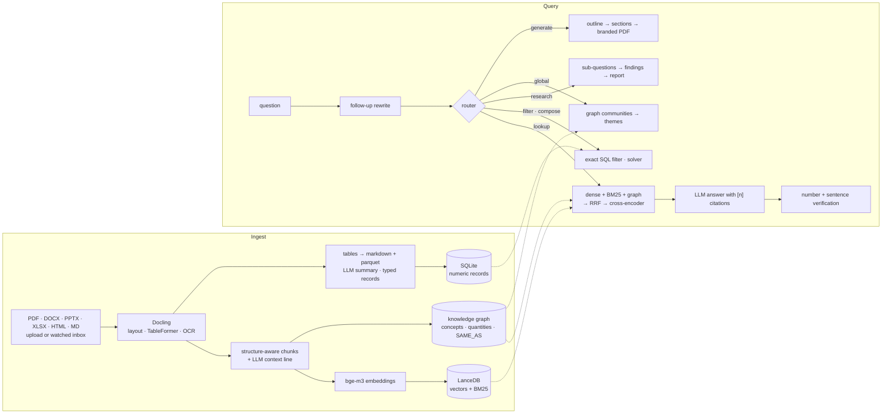

# rag — local document intelligence with a knowledge graph

A private RAG system that reads a company's documents (contracts, budgets, site diaries,
inspection reports, manuals), **finds connections between them** and answers with citations
that open the exact passage in the PDF. On request it writes **branded documents** —
reports, offers, memos — from the same sources.

Everything runs locally: Docling, LanceDB, SQLite and an Ollama model on a laptop. A hosted
LLM is one environment variable away.

<!-- EVAL_SUMMARY -->
> Measured on a 128-question golden set with a local 4B model: **Retrieval MRR 72.9 → 95.5 %** and nDCG@10 76.2 → 96.1 % (plain hybrid → production pipeline); **95.8 %** of answers contain the exact expected facts, **80.0 %** abstain when the corpus has no answer; prompt-injection attack success **16.7 → 0.0 %** with the guard. See [Evaluation](#evaluation).
<!-- /EVAL_SUMMARY -->

## What it does

| | |
|---|---|
| **Ingest** | PDF (incl. scans), DOCX, PPTX, XLSX, HTML, Markdown via Docling — layout, tables, OCR (Apple Vision / Tesseract, Slovak + English). Upload, or drop files into a watched `inbox/` folder (new → indexed, changed → re-indexed, deleted → removed). |
| **Retrieve** | Dense (bge-m3) + BM25 in LanceDB, knowledge-graph expansion for cross-document questions, reciprocal rank fusion, multilingual cross-encoder rerank, Anthropic-style *contextual retrieval* at ingest. Optional ColPali visual page retrieval. |
| **Answer** | Streaming answers with `[n]` citations → PDF opens at the cited page with the passage highlighted. Every number and every sentence is checked against the cited source. Follow-up questions are rewritten into standalone queries; compound questions are decomposed. |
| **Route** | `lookup` (RAG) · `filter` (exact numeric filters over any table: *"samples under 38 MPa"*) · `compose` (planner + exact solver) · `research` (sub-questions → findings → structured report) · `global` (themes across the whole library from graph communities) · `generate` (branded PDF). |
| **Generate** | *"Priprav report o kvalite betónu na Agátovej"* → outline → sections written from sources → PDF styled like the app itself (system-ui text, JetBrains Mono labels, the app's warm neutrals and orange accent); company details, header and footer come from the Settings page. Any chat answer can be exported to PDF. |
| **Integrate** | MCP server (`ask`, `research`, `search_documents`, `find_connections`, `get_document`, `generate_document`) over stdio and streamable HTTP — use the library from Claude Desktop / Claude Code. |
| **Operate** | OpenTelemetry tracing with GenAI semantic conventions (built-in waterfall viewer, optional OTLP → Langfuse / Phoenix), token and latency per stage, thumbs up/down linked to the trace, bad answers exportable to the golden set. |
| **Secure** | Optional login with users, groups and per-document access — filtering happens *inside* the vector and BM25 query. Prompt-injection guard for retrieved content; answers never load remote images. Sandboxed PDF renderer. |

## Architecture



Backend: Python 3.12, FastAPI, uv. Frontend: React 19, Vite, Tailwind 4, shadcn/ui,
react-pdf, react-force-graph. Details and the reasoning behind each choice:
[PLAN.md](PLAN.md) (Slovak), roadmap: [ROADMAP.md](ROADMAP.md).

## Evaluation

The eval runs in-process against a synthetic but deliberately non-trivial corpus
([backend/eval/construction.py](backend/eval/construction.py)): 12 interlinked documents of
a construction company — two projects with the same document types and similar numbers
(distractors), the same subcontractors and people across contracts, supplier lists and
warranty logs, Slovak and English documents. 128 questions with gold document + page:
factual, table, cross-document, multi-hop and unanswerable.

<!-- EVAL_TABLES -->
| Retrieval configuration | Recall@10 | MRR | nDCG@10 | p50 latency |
|---|---:|---:|---:|---:|
| dense | 90.2 | 76.9 | 78.8 | 27 ms |
| bm25 | 81.8 | 68.2 | 70.7 | 4 ms |
| hybrid (dense+bm25, RRF) | 88.6 | 72.9 | 76.2 | 29 ms |
| hybrid + graph on every query | 87.3 | 51.4 | 59.2 | 34 ms |
| hybrid + graph on relational queries | 88.6 | 73.4 | 76.4 | 29 ms |
| hybrid + graph + rerank | 91.1 | 81.3 | 82.9 | 913 ms |
| contextual + hybrid + graph | 98.7 | 83.8 | 87.4 | 31 ms |
| **contextual + hybrid + graph + rerank** | 99.2 | 95.5 | 96.1 | 852 ms |
| … + visual pages (ColSmol, experimental) | 99.2 | 95.5 | 95.9 | 910 ms |

Answer quality (`contextual + hybrid + graph + rerank`, `qwen3:4b-instruct`):

| Metric | Value |
|---|---:|
| Exact expected facts in the answer | 95.8 % |
| Faithfulness — claims supported by sources (LLM judge) | 90.2 % |
| Valid citations | 100.0 % |
| Abstains on unanswerable questions | 80.0 % |
| False refusals | 0.9 % |
| Average end-to-end latency | 8.95 s |

Prompt injection (6 attacks hidden in 3 poisoned documents):

| | Attack success | Task still answered |
|---|---:|---:|
| No defense | 16.7 % | 100.0 % |
| Injection guard | 0.0 % | 100.0 % |
<!-- /EVAL_TABLES -->

Full report with per-type and per-language breakdowns: [backend/eval/REPORT.md](backend/eval/REPORT.md).

What the numbers changed in the design:

- **Graph expansion on every query hurt** (MRR 72.9 → 51.4): graph candidates outvoted dense
  and BM25 in the fusion. It only helps questions about links between documents, so it now
  runs only for relational queries — and the reranker decides the final order.
- **Contextual retrieval was the cheapest big win** — one LLM sentence per chunk at ingest,
  zero query-time cost: MRR 73 → 84, Recall@10 89 → 99.
- **The reranker** takes MRR from 84 to 96 for ~0.9 s per question on Apple GPU (fp16,
  20 candidates). It is on by default on machines with ≥ 32 GB RAM.
- **Visual page retrieval did not help here** — every document in this corpus is born-digital
  text, so ColSmol finds nothing the text index misses. It stays opt-in for scans and drawings.
- **Measuring answers found two bugs that retrieval metrics hide**: a generic numeric filter
  that fired on „…nad 2. NP“ (word-stem matching inside „vyhodnotenia“) and refusals that
  still cited a source. Both fixed; abstention on unanswerable questions went 50 → 80 %.

```bash
make eval           # retrieval ablations (minutes)
make eval-full      # + answer quality with an LLM judge + prompt-injection attacks (~30 min)
make eval-gate      # fails when a metric drops > 2 points below backend/eval/baseline.json
```

## Quick start

### Docker

```bash
docker compose up -d --build     # http://localhost:8080
```

The first start pulls `qwen3:4b-instruct` + `qwen3:1.7b` (~3.6 GB) into a volume. To use a
hosted model instead, set `RAG_LLM_PROVIDER=openai`, `RAG_OPENAI_API_KEY` and
`RAG_ANSWER_MODEL` (any OpenAI-compatible API: OpenAI, Groq, Together, vLLM, LM Studio).

### macOS (native, fastest)

```bash
brew install ollama tesseract tesseract-lang pango
make models                              # pulls the Ollama models
make install                             # uv sync --extra voice + pnpm install
make dev                                 # backend :8000, frontend :5173
```

Voice (Whisper speech-to-text, Piper text-to-speech) is the optional `voice` extra: Whisper
runs on Apple Silicon only and Piper is GPL-3.0, so neither is a core dependency. Without it
(Linux, Docker) reports and questions are text-only. See [THIRD_PARTY.md](THIRD_PARTY.md).

Upload documents in **Dokumenty** (or copy them into `data/inbox/`), ask in **Chat**, explore
links and themes in **Graf**, watch every step in **Traces**, fill in company details for generated documents in
**Nastavenia**, manage accounts in **Používatelia**.

### MCP (Claude Desktop / Claude Code)

```json
{
  "mcpServers": {
    "rag": {
      "command": "uv",
      "args": ["run", "--directory", "/path/to/rag/backend", "python", "-m", "app.mcp_server"]
    }
  }
}
```

Or over HTTP: `claude mcp add --transport http rag http://localhost:8000/mcp`. With login
enabled, create a token in Settings and send it as `Authorization: Bearer …`; the client then
sees only the documents its user may see.

## Configuration

Environment variables with the `RAG_` prefix (or `backend/.env`):

| Variable | Default | |
|---|---|---|
| `RAG_LLM_PROVIDER` | `ollama` | `openai` = any OpenAI-compatible API |
| `RAG_ANSWER_MODEL` / `RAG_EXTRACT_MODEL` | `qwen3:4b-instruct` / `qwen3:1.7b` | answers / extraction |
| `RAG_RAM_PROFILE` | `auto` | `low`: e5-small + mMiniLMv2 reranker; `high` (≥ 32 GB): bge-m3 + bge-reranker-v2-m3 |
| `RAG_RERANK` | profile | cross-encoder rerank |
| `RAG_CONTEXTUAL_CHUNKS` | `true` | LLM context line per chunk at ingest |
| `RAG_GRAPH_EXPANSION` / `RAG_GRAPH_RELATIONAL_ONLY` | `true` / `true` | graph candidates, only for relational queries |
| `RAG_VISUAL_RETRIEVAL` | `false` | ColPali page retrieval (`uv sync --extra visual`) |
| `RAG_INJECTION_GUARD` | `true` | prompt-injection defenses |
| `RAG_AUTH_ENABLED` | `false` | login, groups, per-document access (`RAG_ADMIN_EMAIL`, `RAG_ADMIN_PASSWORD` bootstrap the first admin) |
| `RAG_API_TOKEN_TTL_DAYS` | `90` | lifetime of API (Bearer) tokens |
| `RAG_LOGIN_MAX_FAILURES` / `RAG_LOGIN_WINDOW_MINUTES` | `10` / `15` | failed password/PIN logins per client IP before `429` |
| `RAG_TRUSTED_PROXY` | `false` | take the client IP from `X-Forwarded-For` (only behind your own proxy) |
| `RAG_OTLP_ENDPOINT` / `RAG_OTLP_HEADERS` | — | export traces to Langfuse / Phoenix / Jaeger |
| `RAG_INBOX_SYNC` | `true` | watch `data/inbox` |

## Development

```bash
make test     # pytest (210+ tests) + frontend build
make lint     # ruff check + format, mypy --strict, oxlint
```

CI (GitHub Actions) runs lint, types, tests, the frontend build and both Docker images. The
eval gate needs a local LLM, so it runs locally (`make eval-gate`) rather than in CI.

```
backend/app
  ingest/      Docling parsing, formats, records extraction, inbox sync
  index/       chunking + contextual retrieval, embeddings, LanceDB, visual pages
  graph/       concept extraction, SAME_AS resolution, communities
  retrieve/    router, pipeline, rerank, orchestrator, research, memory, verification
  docgen/      branded PDF generation (outline → sections → WeasyPrint)
  obs/         OpenTelemetry tracing
  api/         FastAPI routes;  mcp_server.py  MCP tools
backend/eval   corpus, golden set, metrics, LLM judge, injection attacks, harness
frontend/src   chat, documents, graph + themes, traces, settings
```

## License

MIT — see [LICENSE](LICENSE). Third-party licences (models, fonts, the optional GPL voice
extra) are listed in [THIRD_PARTY.md](THIRD_PARTY.md).
