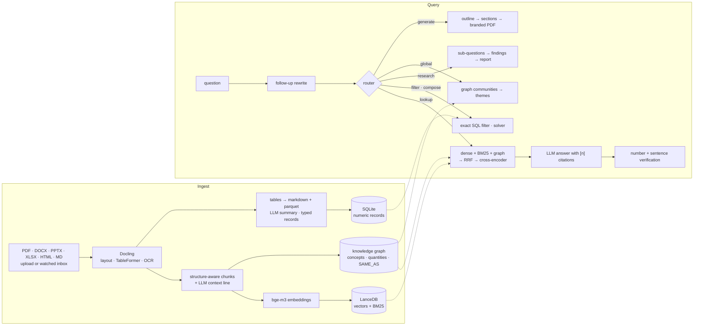

# Architecture

One FastAPI process, one SQLite file, one LanceDB directory and a local Ollama daemon. No
queue, no external services. The pipeline code is plain Python (no LangChain or LlamaIndex),
so every stage can be traced, timed and ablated on its own.

## Components

| Component | Where | Role |
|---|---|---|
| Ingest | `backend/app/ingest/` | Docling parsing (layout, tables, OCR), format handling, typed records from tables, watched `inbox/` sync |
| Index | `backend/app/index/` | Structure-aware chunking with an LLM context line, embeddings, LanceDB (vectors + BM25), optional visual pages |
| Graph | `backend/app/graph/` | Concept and quantity extraction, `SAME_AS` entity resolution across documents, communities for corpus-level questions |
| Retrieval | `backend/app/retrieve/` | Scope guard, router, hybrid pipeline with RRF fusion and rerank, solver, research, answer and verification, secret redaction |
| Document generation | `backend/app/docgen/` | Outline, sections written from sources, WeasyPrint PDF |
| Company module | `backend/app/workforce/`, `backend/app/db/` | Workers, tasks, task import, voice report dialog, Slovak date and number parsing, report PDFs, role-gated company Q&A |
| API and MCP | `backend/app/api/`, `backend/app/mcp_server.py` | REST + SSE for the UI, MCP tools for Claude Desktop / Code |
| Auth and security | `backend/app/auth.py`, `backend/app/security.py` | Users, groups, sessions, API tokens, per-IP login limiter |
| Tracing | `backend/app/obs/` | OpenTelemetry spans into SQLite (viewer in the UI), optional OTLP export |
| Frontend | `frontend/src/` | React 19 SPA (Slovak UI): chat with PDF viewer, documents, graph, traces, task board, attendance, worker phone shell |

## Data flow

1. **Ingest.** A file arrives by upload or in `data/inbox/`. Docling produces a structured
   document; text becomes chunks with page and bounding boxes (used later to highlight the cited
   passage). Tables are kept as markdown plus parquet, and numeric rows become typed records in
   SQLite. A local LLM writes one context sentence per chunk.
2. **Index.** Chunks are embedded and stored in LanceDB together with a BM25 index.
   Context lines are prepended for both.
3. **Graph.** Concepts, quantities and references are extracted per chunk; the same entity in
   different documents is linked (`SAME_AS`), which is what makes cross-document questions
   answerable.
4. **Query.** Follow-ups are rewritten into standalone questions. A scope guard answers
   secrets, system internals and off-purpose questions with a fixed text, without calling
   the LLM. The router then picks a mode: `lookup`, `filter`, `compose`, `research`,
   `global` or `generate` (heuristics first, an LLM only when a number is present and the
   heuristics cannot decide).
5. **Answer.** `lookup` fuses dense, BM25 and (for relational questions) graph candidates with
   reciprocal rank fusion, reranks them with a cross-encoder, and streams an answer with `[n]`
   citations. Afterwards a deterministic check flags numbers missing from the evidence and a
   per-sentence check marks sentences as supported, weak or uncited. Secrets are redacted on
   the way in and out.

## Design decisions

| Decision | Why |
|---|---|
| No LangChain / LlamaIndex | The stages are few and the ablation table needs to switch each one off. Plain functions with tracing are easier to measure and debug than a framework's chains. |
| Numbers and times never come from the LLM | A 4B model invents plausible values. Filters run as SQL, composition questions go to an exact solver (the LLM only assigns numbers from the question to categories, and the plan is discarded if it contains a number that is not in the question), and company-module values are checked against what the person said. |
| Graph expansion only for relational queries | Measured: on every query it dropped MRR from 72.9 to 51.4, because graph candidates outvoted dense and BM25 in the fusion. For relational questions it is neutral to slightly positive (73.4). |
| Contextual retrieval at ingest | One LLM sentence per chunk costs ingest time only. Plain hybrid to contextual hybrid + graph: MRR 72.9 → 83.8, Recall@10 88.6 → 98.7, with no query-time cost. |
| Cross-encoder rerank on by default for 32 GB or more | MRR 83.8 → 95.5 for about 0.9 s per question; the low profile uses a smaller reranker and leaves it off. |
| Access control inside the retrieval query | Filtering after retrieval leaks through ranking and wastes top-k slots. Document ACLs are applied in the LanceDB vector and BM25 queries. |
| Deterministic scope guard before the router | Secrets and system-internals requests never reach the LLM or the index. It also checks unmasked variants ("h-e-s-l-o"). |
| Code decides, LLM structures (company module) | The report dialog is a state machine; "what is missing" is computed by code on every submission; the LLM only converts text to fields. |
| Local first, hosted optional | Ollama by default, any OpenAI-compatible API by configuration. Profiles (`RAG_RAM_PROFILE`) choose models for 16 GB versus 32 GB machines. |

All figures above are from [backend/eval/REPORT.md](../backend/eval/REPORT.md) (synthetic
corpus, 128 questions, one local run). The Slovak design log with the original
reasoning and rejected alternatives is [sk/design-log.md](sk/design-log.md).
